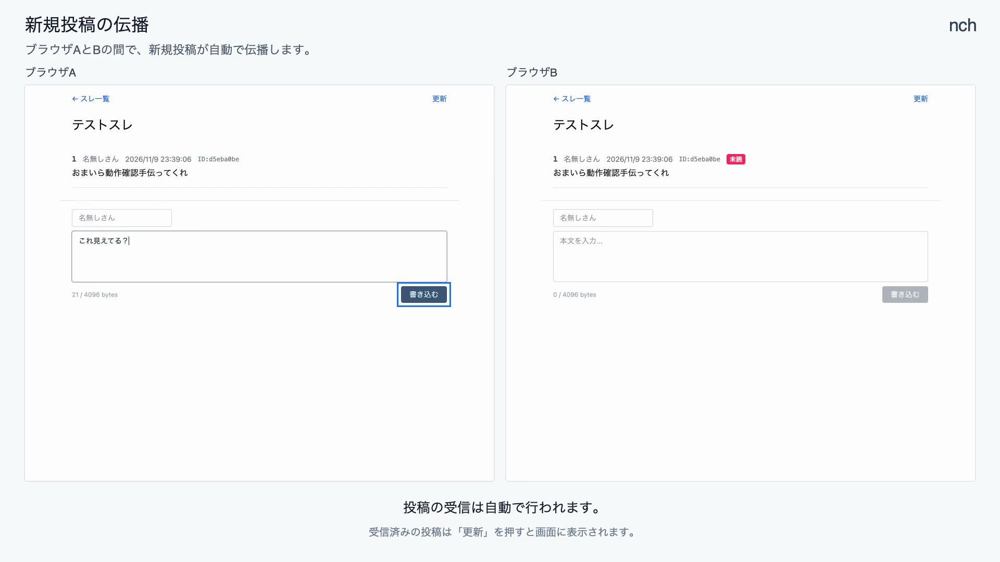
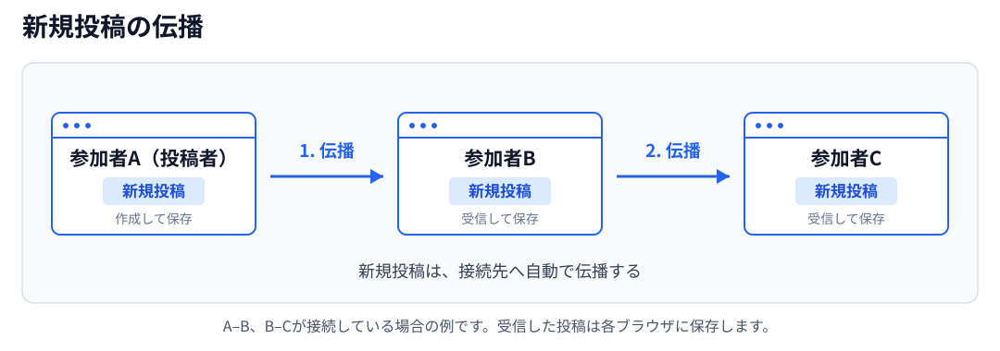
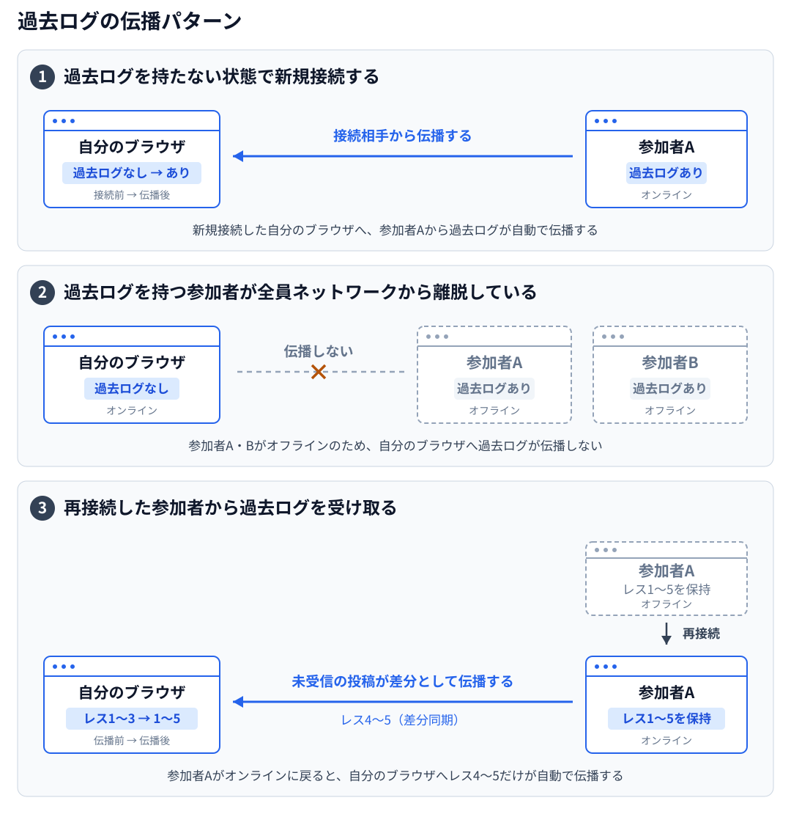
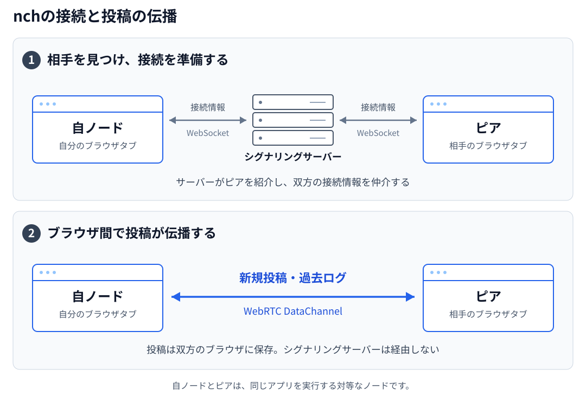

# nch

**投稿も、掲示板も、使う人たちのもの。**\
ブラウザで開いて使えるP2P掲示板。

nchは、参加者のブラウザに投稿を保存し、ブラウザ同士で共有するP2P掲示板です。専用アプリのインストールやポート開放をせずに、スレッドの作成やレスのやり取りができます。

[](./docs/media/nch-demo.mp4)

[デモ動画（約40秒）](./docs/media/nch-demo.mp4)：新規投稿のやり取りと、途中参加したブラウザへの過去ログの伝播。

[公開デモ](https://nch-core.onrender.com/)

## 背景と目的

2026/3に起こった5chのドメイン停止が制作のきっかけです。2ch時代から続く投稿の蓄積は、インターネット文化の歴史の記録でもあると考えます。そのような記録を、サービスの停止で失わずに済む掲示板の仕組みを考えました。

コンテンツは作った人のもの、掲示板のレスは書き込んだ人のものです。その保存と配信をサービス提供者だけが担う構成では、サービスの停止によって、投稿した本人も自分のレスにアクセスできなくなります。nchでは、参加者自身が投稿の保存・共有を担い、コンテンツを自分たちで残せる状態を目指しています。

また、掲示板を動かすソースコードも公開し、他の人が改変・再配布できるようにしています。サービス提供者が開発や提供をやめても、別の人がソフトウェアの保守や掲示板の提供を続けられるようにするためです。

投稿の表示方法や、不要な投稿を非表示にするフィルタリングにも、利用者ごとの好みがあります。将来的には、同じ投稿群に対して、利用者がUIやフィルタリング方法を選べる構成を想定しています。

参加者が関与できる対象と、現在の実装状況は次のとおりです。

| 対象 | 方針 | 現在の実装状況 |
| --- | --- | --- |
| 投稿データ | 自分たちで保持し、他の参加者と共有できる | ブラウザ内への保存とP2P通信を実装。保持・伝播には制限があります |
| ソースコード | 仕組みを調べ、改変し、フォークして継続できる | コードを公開し、AGPL-3.0を採用しています |
| UI・フィルタリング | 同じ投稿群を、自分に合う表示・選別方法で利用できる | 設計上の目標です。差し替えを支える公開APIは未実装です |

投稿の二次利用条件は未整理です。ソフトウェアのライセンスとは別に扱います。

## 使い方

1. **板を選ぶ。** 掲示板を開き、読みたい板を選びます。
2. **スレッドを読む。** 一覧からスレッドを選び、レスを閲覧します。受信した新しいレスは「更新」を押すと表示されます。
3. **レスを投稿する。** スレッドの投稿フォームに書き込みます。
4. **スレッドを立てる。** 板のスレッド一覧から、新しいスレッドを作成できます。

### P2P特有の利用条件

- **同じ板の参加者同士でデータを共有します。** 他の参加者と接続できるまで、初回のスレッド作成・投稿はできません。
- **回線によって接続できない場合があります。** IPv6環境を推奨します（NAT Traversalの問題を極力回避するためです。nchにはTURNサーバがありません。）。公開デモは無料インスタンスのため、サーバーの起動に最大60秒ほどかかることがあります。

一人で動作を試す場合は、別ブラウザまたは別プロファイルで同じURL・同じ板を開いてください。同一プロファイルの別タブは保存領域を共有するため、独立した環境間の投稿の伝播の確認には別のブラウザ環境を使います。

### 投稿の伝播

新規投稿も過去ログも、同じ板の参加者間で自動的に伝播します。投稿データを受け取るための操作は不要です。受信済みの投稿を画面に表示する「更新」は、伝播とは別の操作です。

#### 新規投稿の伝播

投稿すると、接続中の参加者へ自動で伝播します。受信した参加者から、その接続先へも伝播することで投稿が広がります。受信した投稿は、それぞれのブラウザに保存されます。



#### 過去ログの伝播

参加前の投稿も、接続相手が保存していれば自動で伝播します。以前に投稿があっても、そのデータを持つ参加者が不在なら伝播せず、新しく参加したブラウザでは過去の投稿が表示されません。

| 場面 | 参加者の状態 | 過去ログの伝播 |
| --- | --- | --- |
| 1 | 過去ログを持つ参加者に接続できる | 過去ログが伝播する |
| 2 | 過去ログを持つ参加者が全員離脱している | 過去ログが伝播しない |
| 3 | 保存データを持つ参加者が再参加する | 過去ログが再び伝播する |



ブラウザを閉じても、保存データが残っていれば次回参加時に再び伝播させられます。保存領域を消した場合は、そのブラウザから投稿を伝播させることはできません。

## 技術構成

自分のブラウザタブを「自ノード」、接続相手のブラウザタブを「ピア」と呼びます。まずシグナリングサーバーを介して接続を準備し、接続後はブラウザ同士で通信します。



| 領域 | 使用技術 |
| --- | --- |
| フロントエンド | React、TypeScript、Vite、Tailwind CSS |
| ピア間通信 | WebRTC DataChannel、ゴシッププロトコル |
| 接続の仲介 | Node.js、WebSocket |
| ブラウザ内保存 | IndexedDB |
| 改ざん検知 | Web Crypto API、SHA-256、Ed25519 |
| テスト | Vitest、React Testing Library |
| 静的検査・整形 | TypeScript、Biome |

### 主な設計判断

- **投稿の保持・共有を参加者側でも行うため、P2Pを採用しました。**
  - 参加者の端末同士が通信し、それぞれが投稿を保存・転送します。
  - この方式では、データを保持する参加者が必要になることや、共有済みの投稿を一括削除できないことが制約になります。
- **ブラウザを開けば使える操作を実現するため、WebRTCを採用しました。** 専用ソフトの導入やポート開放を必要としない構成です。
- **新規投稿と過去ログで、伝播の仕組みを分けています。**
  - 新規投稿は、受信した参加者が他の参加者へ自動で転送するゴシップ方式で伝播させます。
  - 新規投稿時の伝播だけでは、後から参加した人に過去の投稿が届きません。
  - そのため、接続した相手と保持状況を比較し、過去ログも自動で伝播させる仕組みを設けています。

## ローカルで動かす

### 前提環境

- Node.js 24とnpm（[`.node-version`](.node-version)）
- WebRTC、IndexedDB、Web Crypto APIのEd25519に対応したブラウザ

以下のコマンドはリポジトリのルートから実行します。シグナリングサーバーとフロントエンドは、それぞれ別のターミナルで起動します。

### 1. シグナリングサーバーを起動する

```bash
npm ci
npm run signaling:dev
```

既定のポートは8765です。

### 2. フロントエンドを起動する

別のターミナルで実行します。

```bash
npm run dev -- --port 5173 --strictPort
```

[http://localhost:5173](http://localhost:5173) を開き、板を選択します。既定のシグナリング接続先は `ws://[::1]:8765` です。別の接続先を使う場合は、起動時に `VITE_SIGNALING_URL` を設定してください。

## テスト・チェック

```bash
npm test                 # ドメイン・UseCase・Adapter・UIのテスト
npm run signaling:test   # シグナリングサーバーのテスト
npm run lint             # Biome
npm run typecheck        # フロントエンドの型検査
npm run build            # フロントエンドの型検査とビルド
```

不正な投稿や重複の受信、過去ログの伝播、接続・切断時の処理などをテストしています。接続・伝播処理では通信部分をモックしており、実回線での接続性は別途確認が必要です。

## 利用上の制約

- **接続性:** TURNによる中継を使わないため、NATやファイアウォールの条件によって直接通信できない場合があります。
- **データ保持:** 投稿は各ブラウザに保存されます。保存データが消えた場合の復元や、過去ログの常時提供は保証していません。
- **伝播の完全性:** 途中で取りこぼした投稿や、保持件数が同じで内容が異なる状態を補完できないケースがあります。すべての参加者の投稿が必ず一致することは保証していません。
- **接続の維持:** 大量の同時接続や、参加者が頻繁に入れ替わる状況への対応には課題が残っています。
- **削除・モデレーション:** 投稿の削除、共有済みコピーの回収、フィルタリングは未実装です。荒らしなどへの対応は未解決の課題です。
- **匿名性:** 接続先にIPアドレスを秘匿する仕組みはありません。

板を開くと、他の参加者の投稿を受信・保存・中継します。投稿の責任は各投稿者に帰属します。違法な投稿はしないでください。P2P化は技術デモを目的としており、違法な投稿を許容することは目的ではありません。

## OSSとしての公開方針・ライセンス

ソースコードは **AGPL-3.0** で公開しています。フォークや改変を歓迎します。改変版でも利用者がコードを確認・変更できる状態を保つため、このライセンスを選んでいます。

動作報告や改善提案は [Issues](https://github.com/p2pbbs/p2pbbs/issues) にて歓迎します！

## 関連資料

- [過去ログの伝播の設計メモ](story/adr_sync_past_responses.md)：方式の比較と採用理由。構想段階の記述を含みます。
- [テスト](tests/)・[シグナリングサーバーのテスト](server/tests/)：各処理の振る舞いと境界条件
- [開発方針・ドメイン言語](CLAUDE.md)：AI実装の規約や構想段階の記述を含みます。現在の実装範囲は本READMEを参照してください。
